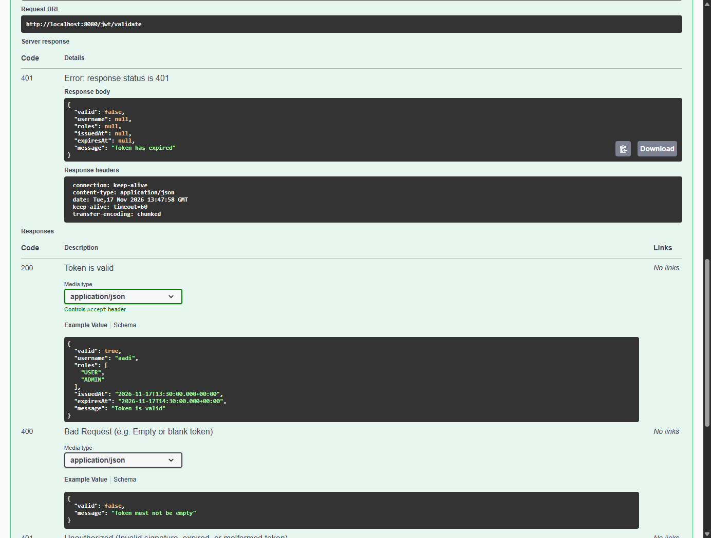

# JWT Token Validation and Claims Extraction Using Spring Boot

- **Project Title:** JWT Token Validation and Claims Extraction Service
- **Student Name:** GARLAPATI YASWANTH ADITHYA REDDY
- **Student ID:** 2400030358
- **Repository:** https://github.com/aadi30358/2400030358-SOAEndSemSkill.git

---

## Screenshots

### 1. Valid Token Validation (200 OK)

### 2. Altered Token Validation (401 Invalid Signature)

### 3. Expired Token Validation (401 Token Expired)

