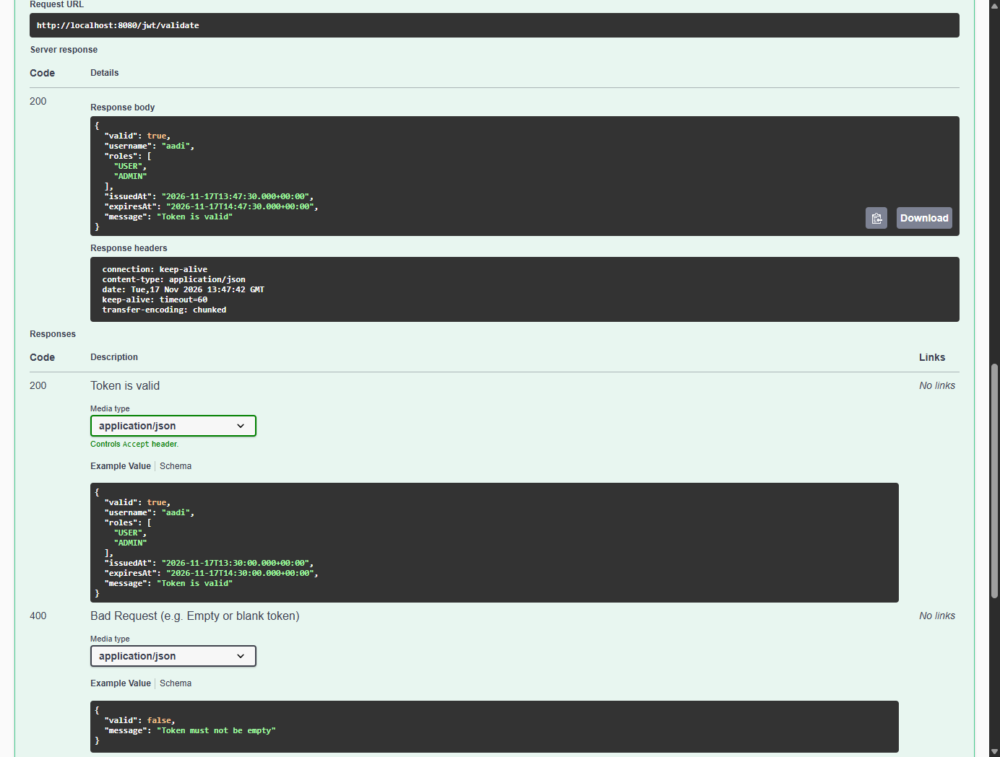

# 2400030358-SOAEndSemSkill: JWT Validation Service

## Project Information
- **Project Name:** 2400030358-SOAEndSemSkill
- **Student ID:** 2400030358
- **Artifact:** jwtvalidator
- **Base Package:** com.klu.jwtvalidator

---

## Tech Stack
- **Java:** 17
- **Spring Boot:** 3.3.5
- **Build Tool:** Maven
- **JWT Library:** JJWT 0.12.6 (`jjwt-api`, `jjwt-impl`, `jjwt-jackson`)
- **API Documentation:** SpringDoc OpenAPI 2.6.0 (`springdoc-openapi-starter-webmvc-ui`)
- **Validation & Utilities:** Spring Boot Starter Validation, Lombok

---

## Screenshots

### 1. Valid Token Validation (200 OK)

### 2. Altered Token Validation (401 Invalid Signature)

### 3. Expired Token Validation (401 Token Expired)

